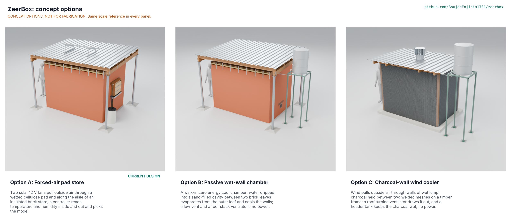

# ZeerBox concept options

Option A, the existing forced-air pad store, scores 190 of 235 against the user requirements; option B, a passive wet-wall chamber, and option C, a charcoal-wall wind cooler, both score 173 (8.9 % below A). All three are within 10 % of the top score, so under STANDARDS section 21 all three go to Amish without a pick (Proposed, awaiting Amish; ZBX-DDR-004). Option A is the current design and stays the design of record unless he decides otherwise; it is the only option that meets the two promises in the pitch, a cooling drop of 8 K or more (PR-002) and a store that tells the user when it is not cooling (PR-004). Method: STANDARDS section 21.

*The options picture is rendered in Blender Cycles from `components()` of every option in `cad/src/model.py` by `python .kit/options.py`, which runs on Amish's Mac; until then the image may be missing.*

All three options share the brief: about 24 crates (480 kg) of mixed vegetables in a walk-in room 2.4 x 1.5 x 2.0 m inside, the 35 °C, 30 % RH design day, 100 kg of warm produce loaded a day, the same timber racks and the same door. They differ in how they cool.

## The options

### Option A: forced-air pad store (the existing design)

Two solar 12 V fans pull outside air through a wetted cellulose pad and along the aisle of an insulated brick store; a controller reads temperature and humidity inside and out and picks the mode. Double fired-brick walls with a dry rice husk cavity, a framed and insulated ceiling, a shade roof on four posts carrying a 150 W panel, a 150 mm pad in the back wall fed from a 60 L sump, two 250 mm fans in a ceiling fan box at the door end, and a controller with a three-color mode lamp. On the design day the store sits at 24.3 °C, 10.7 K below the outside air (9.8 to 11.4 K), at 81 % RH, using 43 L of water and 372 Wh of solar energy (ZBX-CAL-001 v0.4). Key risks: assumed fan and pad curves (STM S3, S5), humidity at the low edge of its target (PR-003), a sealed room if the battery runs flat (ZBX-DEC-001 D3). From the partner: co-design of size, ownership and crops; a pad supplier; a site.

### Option B: passive wet-wall chamber

A walk-in zero energy cool chamber: water dripped into a sand-filled cavity between two brick leaves evaporates from the outer leaf and cools the walls; a low vent and a roof stack ventilate it, with no power. It reuses option A's room, ceiling, roof, door and racks; the cavity holds wet sand, a perforated drip ring lies on the sand under the capping course, a 200 L drum on a 2.2 m welded stand feeds it by gravity, a 200 x 200 mm meshed vent low in the back wall lets air in and a 110 mm stack through the ceiling lets it out, and a dial thermometer and hygrometer hangs by the door. First-order balance (STM B1 to B3): a full store with the day's warm produce is held only about 3 K below outside air (ZECCs with lighter loads measure 4 to 7 K), at 55 to 90 % RH depending on how wet the inner leaf runs, with about 3 air changes an hour that drain cool air out of the low vent and draw 35 °C air in at the stack, using 60 to 70 L of water a day that must be lifted 2.2 m into the tank. Key risks: too little cooling for a full walk-in load; mold in a damp, slowly ventilated room (B5); daily water lifting. From the partner: whether growers accept less cooling for no electrics; watering routine.

### Option C: charcoal-wall wind cooler

Wind pulls outside air through walls of wet lump charcoal held between two welded meshes on a timber frame; a roof turbine ventilator draws it out, and a header tank keeps the charcoal wet, with no power. A concrete slab with eight treated timber posts on galvanised post bases, 100 mm charcoal walls between inner and outer galvanised welded mesh, top plates, a drip pipe threaded through the posts along each wall top, a sheeted roof on four rafters with a 300 mm turbine ventilator, a framed door holding a charcoal panel, and a 200 L tank on a 2.25 m stand. First-order balance (STM C1 to C3, C1 conditional on the airflow): in a light wind about 7 K below outside air, using 30 to 40 L of water a day; on a calm afternoon the turbine barely turns and cooling falls away (the airflow is to assess, C2). Key risks: dependence on wind; galvanised mesh corroding in wet charcoal (C4); mold in the charcoal (C5); a light structure with a 10-year life in doubt. From the partner: local experience with charcoal coolers (they are used for milk and vegetables in Kenya); charcoal and mesh supply.

## First-order numbers

Table 1. Options compared. Costs are estimates from the repo BOM's unit prices and cited benchmarks (ZBX-MKT-001), not quotes; masses and part counts are from `cad/fidelity.json`.

| Quantity | Option A | Option B | Option C |
| --- | --- | --- | --- |
| Estimated parts cost (USD) | 874 (kit 300, structure 574; ZBX-CAL-001 s11) | About 670 (option A's structure less the pad, fan box and kit, plus wet sand, drip ring, tank and stand, vent and stack) | About 520 (slab, timber frame, mesh, charcoal, roof, turbine ventilator to assess, tank and stand, racks) |
| Mass (kg) | 12,480 | 15,041 | 2,468 |
| Output: drop below outside air at the design point | 10.7 K (9.8 to 11.4 K) | About 3 K (full load, first order) | About 7 K in a light wind; little in calm air |
| Store RH while cooling | 81 % (77 to 85 %) | 55 to 90 % (to assess, STM B4) | About 85 to 90 % (estimate) |
| Energy or effort | 372 Wh a day from a 150 W panel; 43 L of water poured into a sump at 0.6 m | No power; 60 to 70 L of water a day lifted 2.2 m | No power; 30 to 40 L of water a day lifted 2.25 m |
| Parts count (D3 model) | 1,181 parts (817 fasteners) | 1,004 parts (706 fasteners) | 538 parts (343 fasteners) |
| STEM check (ZBX-STM-001) | Within known science; 6 plausible rows need data; two fixes made (D1, D5) | Within known science; B4 and B5 plausible | Within known science; C1, C2, C4, C5 plausible (cooling rests on the ventilator's airflow) |

## Scoring

Table 2. Weighted scoring (weights: High UR 3, Medium 2, Low 1; scores 1 to 5).

| Criterion | Source | Weight | A | B | C | Reason |
| --- | --- | --- | --- | --- | --- | --- |
| Hold several days of harvest | UR-001 | 3 | 5 | 5 | 5 | Same 24-crate room in all three |
| Load without heavy lifting | UR-002 | 2 | 5 | 5 | 5 | Same racks, top shelf at 1.40 m |
| Noticeably cooler on hot dry days | UR-003 | 3 | 5 | 2 | 3 | 10.7 K against about 3 K (B, full load) and about 7 K in wind (C) |
| Produce does not wilt | UR-004 | 3 | 4 | 4 | 4 | A at 81 % RH, at risk; B 55 to 90 % depending on how wet its inner leaf runs (STM B4); C high but wind dries it |
| Know when it is not cooling | UR-005 | 3 | 5 | 2 | 2 | A's controller and mode lamp; B and C only a dial the user must read and interpret |
| No mold and safe air | UR-006 | 3 | 4 | 2 | 3 | A has a guard mode and 8 air changes an hour in hold; B is damp and slowly ventilated; C is airy but the charcoal stays wet |
| Produce lasts longer | UR-007 | 3 | 4 | 3 | 3 | Follows cooling and humidity; ZECC evidence is for lighter loads |
| Works without the grid | UR-008 | 3 | 4 | 5 | 5 | A needs its solar kit and battery; B and C need no power |
| Water I can carry | UR-009 | 2 | 4 | 1 | 2 | A 43 L poured into a ground-level sump; B 60 to 70 L and C 30 to 40 L lifted into a tank above head height every day |
| Safe to touch and work on | UR-010 | 3 | 4 | 5 | 5 | A is 12 V with guarded fans; B and C have no electrics |
| Built by local trades | UR-011 | 3 | 4 | 5 | 4 | A adds a 12 V installation; B is masonry and plumbing; C needs mesh work and a charcoal supply |
| Mended from the regional town | UR-012 | 3 | 3 | 4 | 3 | A has fans, pump, sensors and pad to replace; B only a drip ring and tank; C mesh and charcoal |
| Lasts in heat, dust, termites and wind | UR-013 | 2 | 4 | 3 | 2 | A's dry brick and steel roof; B's walls stay wet; C's timber and mesh sit in wet charcoal |
| Affordable to a group | UR-014 | 3 | 3 | 4 | 4 | About USD 874, 670 and 520 |
| Cost against the value-engineering target | project.yaml | 2 | 3 | 5 | 5 | A's kit is at the USD 300 target; B's and C's water kits are well under it |
| Buildable with local skills and tools | | 2 | 4 | 5 | 4 | As UR-011, from the build side |
| Safety | ZBX-RSK-001 | 3 | 4 | 3 | 4 | A: battery and fans managed, sealed-room risk when flat (D3); B: damp sealed room; C: open structure |
| Maintenance | | 1 | 3 | 3 | 2 | A: weekly sump and pad routine; B: daily water lifting; C: daily water and charcoal renewal |
| **Weighted total (of 235)** | | | **190** | **173** | **173** | |

Sensitivity: if the pitch's two promises (UR-003 cooling, UR-005 knowing the mode) are treated as must-meet, options B and C fail both and only option A remains. If the store must work with no electrical parts at all, option A drops out and option C leads B on cooling while B leads C on durability.

## Recommendation

All three options are within 10 % of the top score, so all three go to Amish without a pick (STANDARDS section 21), recorded as "Proposed, awaiting Amish" in ZBX-DEC-001 (D2) and argued in ZBX-DDR-004. Option A remains the design of record: it is the current design, the only one that meets PR-002 and PR-004, and the repo is not redesigned without Amish's go.

The runner-up's best idea to graft onto option A, whichever is chosen: option B's passive ventilation path (a low vent and a stack), topped with option C's turbine ventilator head, as the always-open air path that keeps the room safe to enter when option A's battery is flat. That graft is the subject of ZBX-DEC-001 D3, proposed to Amish with this recommendation because it lets some cooled air out on design days and so is a safety trade-off.
